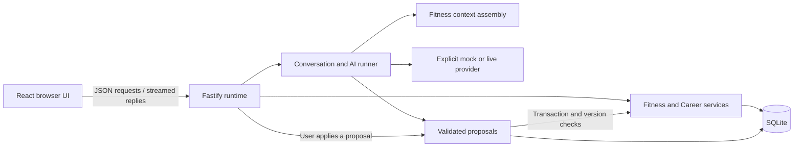

# Sahale application architecture

[Project overview](../README.md) · [SQLite case study](case-studies/sqlite-migrations.md)
· [AI proposal case study](case-studies/ai-proposals.md)

This describes the application's source code and tests as of 2026-10-14. It
reflects the code as written, not a recent test run or a live deployment.
Source paths refer to the application's private repository, not to files in
this one.

## Components and data flow



The React shell supplies hierarchical routes, a command palette, and a
contextual Ask panel. React Router owns URLs; Zustand holds UI state and the
latest runtime snapshots. Shared TypeScript types and Zod schemas connect
browser requests to server validation.

Fastify registers separate Fitness, Career, conversation, AI, and runtime
routes. Services own database mutations rather than allowing UI code or model
output to write tables directly. Fitness and Career stores serialize browser
writes and adopt snapshots after the server commits. Errors remain visible;
version conflicts prevent an older editor from overwriting newer state.

## Implemented domains

**Fitness** separates reusable workout templates, dated plans, active sessions,
and completed history. Starting a workout creates durable set rows and a
prescription snapshot. Entered values and completed sets are distinct. Finishing
a session records history transactionally; later template edits do not rewrite
its original prescription. Rest timers use persisted deadlines with pause,
resume, skip, and time adjustment controls.

**Career** persists applications and their status changes. A status change and
its history row commit together. Edits carry the version the editor saw; a
conflict returns an error instead of silently overwriting. Recorded timestamps
and user-supplied occurrence dates are separate. CSV export quotes values and
neutralizes spreadsheet formulas. The tracker has no automatic employer
ingestion, application submission, or inferred rejection workflow.

**Fitness Ask** assembles context from runtime records and explicitly labelled
mock/demo sources. The user can inspect a context manifest and control source
inclusion. The runner persists messages, run status, and partial replies. A
failed live request is surfaced rather than silently answered by the mock
provider. Only Fitness uses this runtime-backed assistant; other Ask scopes
use the prototype responder.

## Persistence and schema evolution

SQLite is the durable store for implemented domains, conversations, runs,
proposals, committed actions, and runtime settings. The runtime uses
better-sqlite3 through Drizzle ORM, with WAL mode, full synchronization, foreign
keys, and a busy timeout. Ordered SQL migrations are tracked by hash.

For an existing database that needs migration, startup takes an online backup
before applying pending changes. Pending migrations run in one transaction;
foreign-key checking must succeed before commit. Unknown or modified applied
migrations stop normal database use. The runtime can still explain the failure,
while database-dependent routes return an unavailable response.

Prototype state has a different boundary: School interactions, food additions,
and prototype threads use browser localStorage where applicable. Browser
persistence does not establish equivalent backend integration or cross-device
durability. The server has no routes for School, Computing, Food, or Sleep, and
it does not collect live infrastructure data.

## Development and verification

The application requires Node.js 22 or newer and its declared dependencies,
including the native SQLite binding. Its scripts:

```sh
npm run dev        # Fastify runtime and Vite together
npm run typecheck
npm run lint
npm test           # Vitest service/API tests
npm run build      # TypeScript build and browser assets
npm start          # Runtime serves built assets
```

Vite proxies `/api` requests to the local runtime during development. For an
isolated development instance, `SAHALE_DATA_DIR` selects the runtime data root;
it should be separate from personal application data. Startup can create and
migrate a database. Database commands include `npm run db -- backup` and
`npm run db -- migrate`; even the `status` command opens the database and can
apply pending migrations, so it is not a read-only inspection command.

Vitest coverage includes persistence across reopening a database, migration
backup and rollback, workout/session separation, rest deadlines, stale edits,
Career history and CSV safety, host/origin/identity rejection, context assembly,
stream failures, and proposal application. Providers and clocks are injected
and database fixtures are temporary. This is primarily service and HTTP
coverage, not evidence of end-to-end browser or live-provider reliability.

## Self-hosted packaging and access assumptions

The application includes Linux systemd units for the runtime and scheduled
SQLite snapshots. The runtime can serve the compiled browser assets from the
same process. The snapshot helper uses SQLite's online backup API, checks
integrity and foreign keys, and atomically replaces the destination snapshot.
This is database snapshot tooling, not a complete off-host backup or proven
disaster-recovery system.

The default runtime binds to loopback. Private remote access is designed around
Tailscale Serve: it requires a configured HTTPS origin and the one allowed
Tailscale login, and the runtime checks host, origin, and the trusted proxy's
identity headers.
Mutating API requests also require the application's client header. That
header alone is not authentication. This boundary assumes a trusted local
machine and a correctly configured Serve proxy that strips spoofed identity
headers; it is not a general public, multi-user authentication system.

This section describes packaging and request checks in source. No live host,
reverse proxy, backup schedule, restore, or remote AI service was checked for
this documentation.

## Source map

| Subject | Source (private repository) | Tests |
| --- | --- | --- |
| Browser/runtime boundary | `src/state/fitness.ts`, `src/state/career.ts`, `server/app.ts` | `test/fitness.test.ts`, `test/career.test.ts`, `test/access.test.ts` |
| Workouts and rest | `server/fitness/service.ts`, `server/db/schema.ts`, `shared/fitness/derive.ts` | `test/workouts.test.ts`, `test/rest.test.ts` |
| Career records/export | `server/career/service.ts`, `server/career/csv.ts` | `test/career.test.ts`, `test/career-nomock.test.ts` |
| SQLite evolution | `server/db/index.ts`, `server/db/migrations/` | `test/db.test.ts`, `test/workouts.test.ts`, `test/rest.test.ts`, `test/career.test.ts` |
| Assistant/context/proposals | `server/ai/runner.ts`, `server/ai/gateway.ts`, `server/context/fitness.ts`, `server/proposals/service.ts` | `test/ai.test.ts`, `test/context.test.ts`, `test/proposals.test.ts`, `test/workouts.test.ts` |
| Prototype boundary | `src/app/router.tsx`, `src/ask/AskPanel.tsx`, `src/state/school.ts`, `src/state/food.ts`, `src/state/persist.ts` | Not tested as features; browser storage, no server routes |
| Hosting/snapshots | `deploy/sahale.service`, `deploy/sahale-snapshot.service`, `deploy/sahale-snapshot.timer`, `deploy/sahale-sqlite.py` | None; packaging only |
