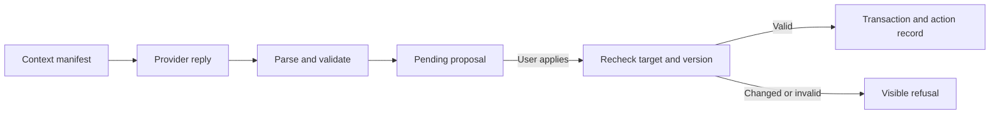

# AI suggestions with explicit, transactional application

[Architecture](../architecture.md) · [Project overview](../../README.md)

An assistant can suggest a workout change while you keep logging sets or edit
the same plan elsewhere. A generated response may also be malformed,
interrupted, or based on state that is no longer current. Sahale's Fitness
assistant separates generating a suggestion from applying a change.

## From context to a pending proposal

The runtime builds a Fitness context manifest from selected sources, including
their provenance and available record state. The user can preview and adjust
context inclusion. An explicit provider selection chooses offline mock or live
responses. Live failure remains a visible failure; the gateway does not
silently substitute a mock answer.

The runner persists the conversation and run independently of the browser's
connection. Partial text can survive an interrupted stream, but proposal
creation requires provider-confirmed completion. Structured output is parsed
and validated against the proposal schema and actual Fitness records.
Creating a pending proposal does not modify the workout.

## The application boundary

Proposals target a particular dated plan or active session. On Apply, the
service reloads the target, checks its version and applicable constraints, and
commits the domain change together with its action record and proposal status.
A stale proposal is refused. A plan currently being logged is not rewritten
through the plan-adjustment path. Session adjustments preserve sets already
logged or entered and apply only permissible changes to remaining work.

For example, you can ask for a shorter workout and review the proposed
changes. If the session is finished before Apply, the suggestion becomes stale
rather than rewriting completed history. Applying a change is a separate HTTP
action; model text cannot bypass the service's checks.

The action record captures before/after state and versions. Revert is guarded
by subsequent target changes rather than promising unconditional undo.
Dismiss leaves Fitness state untouched.

## Evidence and practical limits

The application's `test/proposals.test.ts` checks creation without
mutation, atomic application, rollback on a mid-commit failure, stale targets,
invalid output, dismissal, and guarded revert. `test/workouts.test.ts` checks
active-session adjustments and refusal after session completion.
`test/ai.test.ts` covers streaming, cancellation, timeouts, interrupted replies,
explicit mock behavior, and no silent live-to-mock fallback.
`test/context.test.ts` covers provenance, inclusion overrides, empty/stale
state, and bounded conversation context. The implementation is in
`server/ai/runner.ts`, `server/ai/gateway.ts`, `server/context/fitness.ts`, and
`server/proposals/service.ts`.

These tests use injected providers and synthetic database state, so they do
not exercise a real provider. The checks constrain supported database actions,
not the factual quality or suitability of fitness advice. Context can include
labelled demo/mock inputs. Live use sends the selected context to an external
provider, so choosing what to include is also a privacy decision.

The implemented action surface is narrow: Fitness plans and live sessions.
It is not autonomous control over every application domain or the Homelab.
